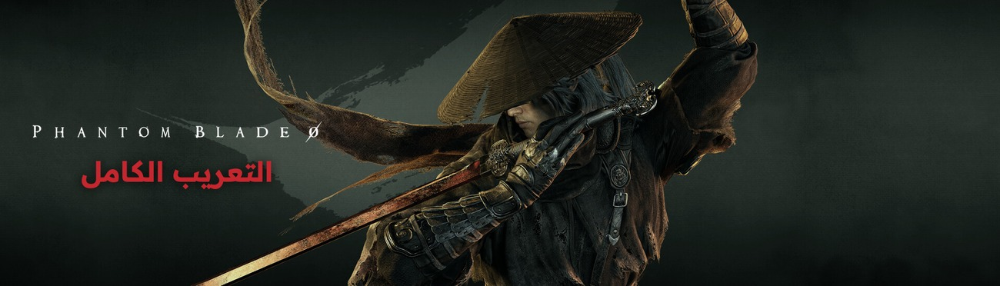

# Phantom Blade Zero - التعريب الكامل

تعريب كامل لـPhantom Blade Zero على Steam بترجمة مباشرة من النص الصيني الأصلي: القصة والحوارات، والمهام، والأسلحة والأغراض، والشخصيات والأعداء والزعماء، والقوائم ورسائل النظام، والشروحات وشاشات التحميل، والإنجازات، مع خط Readex Pro. العربية لغة إضافية تظهر في قائمة لغات اللعبة باسم «العربية»، ولا تتغير الأصوات ولا اللغات الأخرى.

## التحميل

من صفحة [الإصدارات](../../releases/latest) حمّل ملف `PhantomBladeZero-Arabic-v1.0.4.exe`.

أو حمّله من [Nexus Mods](https://www.nexusmods.com/phantombladezero/mods/59).

## التثبيت

1. أغلق اللعبة.
2. شغّل المثبّت واضغط «تثبيت اللغة العربية». يجد المثبّت اللعبة تلقائيًا من مكتبة Steam، ويمكنك اختيار مجلدها يدويًا.
3. شغّل اللعبة واختر «العربية» من قائمة اللغة في الإعدادات.

إن ظهرت رسالة "Windows protected your PC" اضغط More info ثم Run anyway.

للإزالة: شغّل المثبّت واضغط «إزالة اللغة العربية».

## تنبيه

- صُمّم لإصدار Steam، رقم البناء 26266538. بعد أي تحديث للعبة انتظر نسخة جديدة من التعريب.
- يضيف المثبّت ملف version.dll في platform\steam، وهو الذي يضيف «العربية» إلى قائمة اللغات. إن كان في المجلد ملف version.dll من تعديل آخر، يحتفظ به المثبّت ويعمل التعديلان معًا.
- بعض الشروحات وأسماء المناطق تبدأ من اليسار كما في النسخة الإنجليزية، حتى تظهر كاملة داخل الفقاعات وخانة ملف الحفظ.
- أخبرنا بأي نص غير مترجم أو خارج مكانه مع صورة في [Issues](../../issues).

## شكر وتقدير

- S-GAME على اللعبة.
- خط Readex Pro من تصميم Thomas Jockin وNadine Chahine، مرخّص برخصة SIL Open Font License 1.1.
- خط Rubik في المثبّت مرخّص برخصة SIL Open Font License 1.1.

أعجبك التعريب؟ ادعمني على Ko-fi: https://ko-fi.com/kindiboy

---

Full Arabic localization of Phantom Blade Zero (Steam, build 26266538), translated directly from the original Chinese script: 10,769 lines covering the story and dialogue, quests, weapons and items, characters, enemies and bosses, menus, tutorials, loading screens and achievements, with the Readex Pro font. Arabic is added as an extra language; voices and the other languages are unchanged, and the game's own files are not modified. Download the installer from [Releases](../../releases/latest) or [Nexus Mods](https://www.nexusmods.com/phantombladezero/mods/59).

This is a fan project, not affiliated with or endorsed by S-GAME. Phantom Blade Zero is a trademark of its respective owner.
